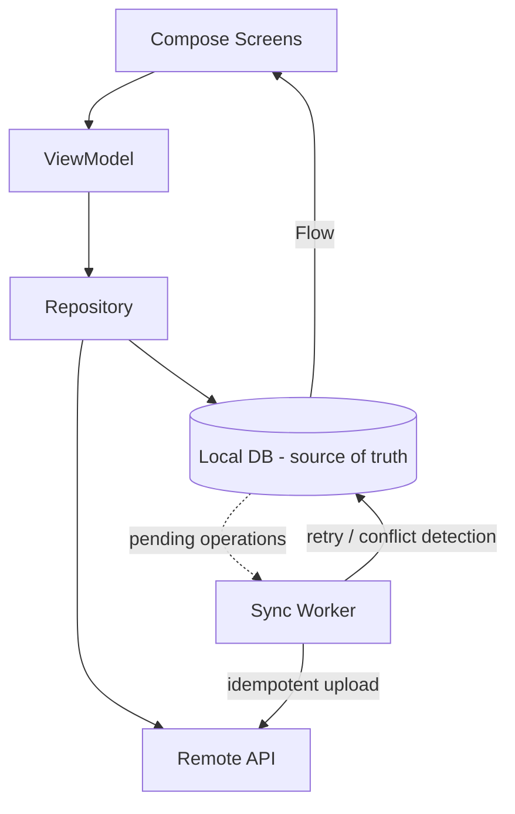

# incsync

**Offline-first personal notes for Android.** Your notes remain usable even when the internet doesn't.

> Status: **Milestone 1 complete** — project skeleton, navigation, architecture foundation.

## Why offline-first

Notes are written on the device first. The local database is the single source of truth for
everything the user sees; synchronization with the backend happens *independently* behind the UI.
The app never blocks on the network, never loses a keystroke to a flaky connection, and never
shows a spinner just to read a note.

## Architecture

```
Compose UI  ← StateFlow ←  ViewModel  ←  Repository  ←  Local data source (Room, Milestone 2)
                                              │              Remote data source (Retrofit, Milestone 3)
                                              └→ pending sync ops → WorkManager (Milestones 4–7)
```



**Rules of the architecture**

- UI renders immutable state; it never reaches into data sources.
- Every local write goes through the repository in one atomic step (note + pending sync op).
- Synchronization is persistent work (WorkManager), not a coroutine — it survives process death.
- Failures are classified: transient errors retry with backoff, permanent errors surface in the UI.

## Current milestone (M1)

- Gradle + version catalog, Kotlin 2.0, Compose, Material 3, Hilt
- Adaptive shell: bottom navigation on phones, navigation rail on tablets/wide screens
- Minimal "ink on paper" theme: near-monochrome, color reserved for sync state
- Screens: Notes home, write-through editor, offline search, folders, settings, sync status
- `NotesRepository` interface with an in-memory implementation (swapped for Room in M2)
- Unit tests for ViewModel aggregation logic (5 passing)

Verified on emulator: create → edit → persist → search, all offline.

## Project structure

```
app/src/main/java/com/inc/app/
├── IncSyncApp.kt          # Hilt application
├── MainActivity.kt        # single activity, theme + adaptive root
├── domain/                # models + repository interface (no framework deps)
├── data/                  # in-memory source of truth (Room in M2)
├── di/                    # Hilt bindings
└── ui/
    ├── navigation/        # routes + NavHost
    ├── notes/             # home + editor
    ├── search/            # offline search
    ├── folders/           # folder shell (CRUD lands with Room)
    ├── settings/          # theme, sync entry, about
    ├── sync/              # sync status & history
    ├── components/        # sync chip, empty states
    └── theme/             # colors, type, shapes
```

## Build & run

```bash
./gradlew :app:assembleDebug        # build APK
./gradlew :app:testDebugUnitTest    # unit tests
./gradlew :app:installDebug         # install on connected device/emulator
```

Requires JDK 17 and the Android SDK (compileSdk 35, minSdk 26).

## Roadmap

| Milestone | Scope |
|---|---|
| 2 | Room as the local source of truth |
| 3 | Auth + FastAPI/PostgreSQL backend |
| 4–6 | Remote sync, offline write queue, WorkManager |
| 7–9 | Idempotency, retries, multi-device conflict detection & resolution |
| 10 | Search (FTS) + folders + polish |
| 11 | Testing & failure injection |
| 12 | Release build + Play Store preparation |

## Privacy

Note content is never logged, never sent to analytics, and never appears in crash reports.
Credentials will be stored with platform secure storage (Milestone 3).
