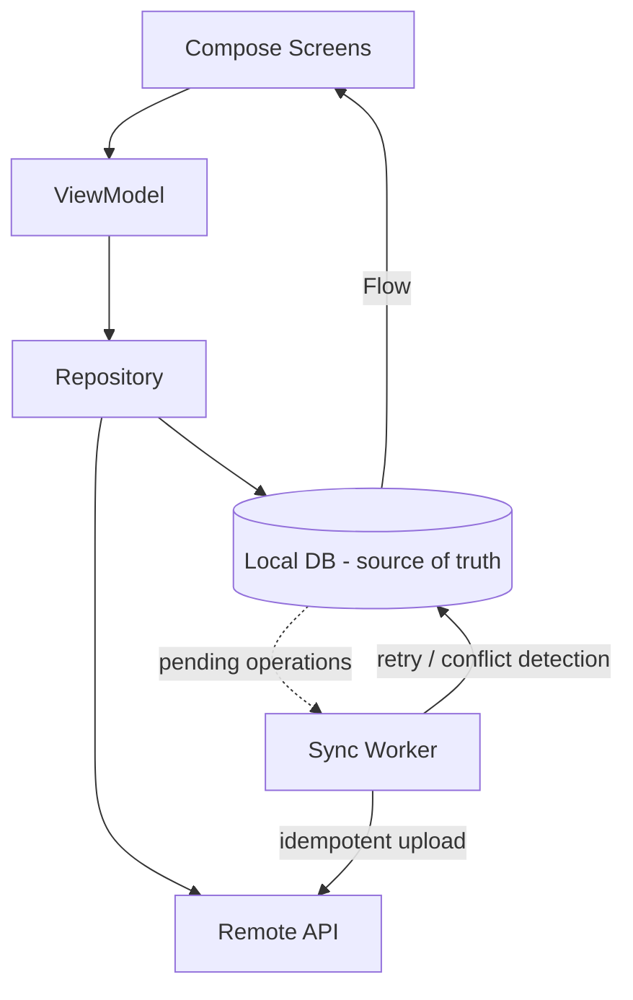

# incsync

**Offline-first personal notes for Android, backed by a FastAPI service.** Notes are written to the
device first; the local database is the single source of truth for everything the user sees, and
synchronization with the backend happens independently behind the UI. The app never blocks on the
network, never loses a keystroke to a flaky connection, and never shows a spinner just to read a
note.

> Status: **Complete** — offline-first notes, authentication, bidirectional sync, full-text search,
> folders, conflict resolution, encrypted credential storage, failure-injection tests, and a
> release-ready build are all implemented and verified.

---

## Table of contents

1. [Why offline-first](#why-offline-first)
2. [Architecture](#architecture)
3. [Feature set](#feature-set)
4. [Project structure](#project-structure)
5. [Backend service](#backend-service)
6. [Data model](#data-model)
7. [Synchronization protocol](#synchronization-protocol)
8. [Build & run](#build--run)
9. [Configuration](#configuration)
10. [Testing](#testing)
11. [Release build](#release-build)
12. [Roadmap status](#roadmap-status)
13. [Privacy & security](#privacy--security)
14. [Contributing](#contributing)
15. [License](#license)

---

## Why offline-first

- **Local is the source of truth.** Every screen reads from Room through reactive `Flow`s; Compose
  recomposes automatically when the underlying data changes.
- **Writes are atomic.** A note change and its pending sync operation are persisted in a single
  Room transaction, so a process kill can never separate a row from its "needs to sync" marker.
- **Sync is persistent work.** WorkManager drains the pending-op queue with network constraints,
  exponential backoff, and survives process death and device reboots.
- **Failures are classified.** Transient errors (I/O, 5xx) retry with backoff; permanent errors
  (4xx) are surfaced as `FAILED` / `CONFLICT` states in the UI instead of being retried forever.
- **No blocking reads.** Opening, editing, searching, and deleting notes never touch the network.

## Architecture

```
Compose UI  ← StateFlow ←  ViewModel  ←  Repository  ←  Local data source (Room, source of truth)
                                                  │              Remote data source (Retrofit)
                                                  └→ pending sync ops → WorkManager
```



**Rules of the architecture**

- UI renders immutable state; it never reaches into data sources directly.
- Every local write goes through the repository in one atomic step (entity + pending sync op).
- Synchronization is persistent work (WorkManager), not a coroutine — it survives process death.
- Failures are classified: transient errors retry with backoff, permanent errors surface in the UI.
- Domain models (`com.inc.app.domain`) carry no framework annotations; persistence and network
  types are mapped at the repository boundary, keeping UI code free of Room/Retrofit details.

### Key components

| Layer | Responsibility |
|---|---|
| `domain` | Plain Kotlin models (`Note`, `Folder`, `SyncState`) and the `NotesRepository` interface. |
| `data.local` | Room entities (`NoteEntity`, `FolderEntity`, `PendingOpEntity`, `NoteFtsEntity`), DAOs, database, migrations. |
| `data.remote` | Retrofit `IncSyncApi`, serializable DTOs, `TokenStore` (encrypted). |
| `data.repository` | `RoomNotesRepository` — the single implementation of `NotesRepository`; maps entity ↔ domain; records pending ops transactionally. |
| `data.sync` | `SyncWorker` (drains the queue) and `SyncScheduler` (enqueues unique work). |
| `di` | Hilt modules binding Room, network, and repository implementations. |
| `ui` | Compose screens + ViewModels; consume `StateFlow<UiState>` only. |

## Feature set

- **Notes** — create, edit (write-through, no save button), pin, delete. Deletions are hard-deletes
  locally but enqueue a `DELETE` sync op so the server is updated.
- **Folders** — create, rename, delete; notes reference a `folderId`. Folder mutations are queued
  and synced like notes.
- **Offline search** — Room FTS4 full-text search over note titles and bodies, exposed as a
  reactive `Flow`.
- **Sync** — idempotent push of `CREATE` / `UPDATE` / `DELETE` with optimistic concurrency
  (`base_version`), conflict detection on `409`, exponential-backoff retry, per-row `SyncState`.
- **Auth** — register / login / logout against the FastAPI backend; bearer-token OkHttp
  interceptor; encrypted token storage.
- **Conflict resolution** — when a note diverges on the server, the editor offers "keep mine"
  (overwrite server) or "use server version" (discard local).
- **Adaptive UI** — bottom bar on phones, navigation rail on wide screens; Material 3 theme with
  color reserved for sync state.
- **Sync status** — app-wide chip aggregated from per-note states
  (`SYNCED` / `PENDING` / `FAILED` / `CONFLICT` / `SYNCING` / `OFFLINE`).

## Project structure

```
app/src/main/java/com/inc/app/
├── IncSyncApp.kt          # Hilt application + WorkManager configuration
├── MainActivity.kt        # single activity, theme + adaptive root
├── domain/                # models + repository interface (no framework deps)
├── data/
│   ├── local/             # Room entities, DAOs, database, FTS
│   ├── remote/            # Retrofit API, DTOs, TokenStore
│   ├── repository/        # Room-backed repository (entity ↔ domain boundary)
│   └── sync/              # SyncWorker, SyncScheduler
├── di/                    # Hilt modules (data, network, Room)
└── ui/
    ├── navigation/        # routes + NavHost
    ├── notes/             # home + editor
    ├── search/            # FTS-backed search
    ├── folders/           # folder CRUD
    ├── settings/          # theme, account, about
    ├── sync/              # sync status & history
    ├── auth/              # login / register
    ├── components/        # sync chip, empty states
    └── theme/             # colors, type, shapes

server/                    # FastAPI + SQLAlchemy backend
```

## Backend service

FastAPI (Python 3.11+) with SQLAlchemy, JWT auth, and a SQLite/PostgreSQL store.

### Run locally

```bash
cd server
python -m venv .venv
# Windows: .venv\Scripts\activate   |   macOS/Linux: source .venv/bin/activate
pip install -r requirements.txt
DATABASE_URL="sqlite:///./dev.db" uvicorn app.main:app --reload --port 8000
```

### Test

```bash
cd server
DATABASE_URL="sqlite:///:memory:" python -m pytest -q
```

### API surface (selected)

| Method | Path | Purpose |
|---|---|---|
| `POST` | `/auth/register` | Create account, return JWT. |
| `POST` | `/auth/login` | Authenticate, return JWT. |
| `GET`  | `/auth/me` | Current user. |
| `GET`  | `/notes` | List notes. |
| `POST` | `/notes` | Create note (client-supplied id, idempotent). |
| `GET`  | `/notes/{id}` | Fetch one note (used for conflict resolution). |
| `PUT`  | `/notes/{id}` | Update with `base_version` optimistic concurrency. |
| `DELETE` | `/notes/{id}` | Delete (idempotent; 404 treated as success). |
| `GET`/`POST`/`PUT`/`DELETE` | `/folders[/{id}]` | Folder CRUD with versioning. |

`PUT /notes/{id}` returns `409 Conflict` with the server's current note when `base_version`
does not match, enabling multi-device conflict detection.

## Data model

### `notes` table

| Column | Type | Notes |
|---|---|---|
| `id` | TEXT (PK) | Client-generated UUID; offline creation requires this. |
| `userId` | TEXT | Owner; `"local-user"` until authenticated. |
| `title`, `content` | TEXT | Note body. |
| `folderId` | TEXT (nullable) | Optional folder. |
| `isPinned` | INTEGER | Boolean. |
| `createdAt`, `updatedAt` | INTEGER | Epoch millis. |
| `version` | INTEGER | Optimistic-concurrency token; bumped on every accepted edit. |
| `syncState` | TEXT | `PENDING` / `SYNCED` / `SYNCING` / `FAILED` / `CONFLICT`. |
| `deletedAt` | INTEGER (nullable) | Soft-delete marker; row retained until sync confirms. |
| `syncedVersion` | INTEGER | Last version acknowledged by the server (0 = never synced). |

### `folders` table

| Column | Type | Notes |
|---|---|---|
| `id` | TEXT (PK) | Client-generated UUID. |
| `userId` | TEXT | Owner. |
| `name` | TEXT | Display name. |
| `createdAt`, `updatedAt` | INTEGER | Epoch millis. |
| `version` | INTEGER | Optimistic-concurrency token. |
| `syncState` | TEXT | Sync state. |
| `syncedVersion` | INTEGER | Last server-acknowledged version. |

### `pending_ops` table

| Column | Type | Notes |
|---|---|---|
| `id` | INTEGER (PK, autoincrement) | Queue ordering. |
| `opType` | TEXT | `CREATE` / `UPDATE` / `DELETE` / `FOLDER_CREATE` / `FOLDER_RENAME` / `FOLDER_DELETE`. |
| `noteId` | TEXT | Target resource id (note or folder). |
| `payload` | TEXT (nullable) | Reserved for future JSON snapshots. |
| `createdAt` | INTEGER | Enqueue time. |
| `attempts` | INTEGER | Retry counter. |
| `lastError` | TEXT (nullable) | Last failure message. |

### `notes_fts` (FTS4, external content)

Virtual table backed by `notes`; kept in sync via Room-generated triggers. Supports
`MATCH` queries over `title` and `content`.

## Synchronization protocol

1. **Local write** — repository wraps the entity change + a `pending_ops` row in one
   `db.withTransaction { }`, then calls `SyncScheduler.schedule()`.
2. **Enqueue work** — `SyncScheduler` enqueues a unique `OneTimeWorkRequest` (`incsync-sync`)
   with a `CONNECTED` network constraint (kept if already queued).
3. **Drain** — `SyncWorker.doWork()` (coroutine worker) runs when connected:
   - If unauthenticated, succeed quietly and leave ops queued.
   - For each pending op (ordered by `createdAt`):
     - `CREATE` → `POST /notes`; on 2xx mark `SYNCED` and store server version; on 409 mark
       `FAILED`; on 5xx/IOException → `Result.retry()`.
     - `UPDATE` → `PUT /notes/{id}` with `base_version = syncedVersion`; on 409 mark
       `CONFLICT` (server version stored, local content preserved).
     - `DELETE` → `DELETE /notes/{id}`; 404 treated as success.
   - Folder ops follow the same pattern against `/folders`.
4. **Retry classification** — I/O and 5xx return `Result.retry()` (WorkManager backoff);
   4xx marks the op failed and removes it from the queue.
5. **Status aggregation** — `NotesViewModel` maps per-note states to an app-wide
   `SyncStatus` (`CONFLICT` > `FAILED` > `PENDING` > `SYNCED`).

Idempotency: client-generated UUIDs make `CREATE` safe to replay; the server treats a repeat
`POST` with an existing id as a no-op success.

## Build & run

### Prerequisites

- JDK 17
- Android SDK (compileSdk 35, minSdk 26)
- Python 3.11+ and `pip` (for the backend)

### Android

```bash
./gradlew :app:assembleDebug            # build debug APK
./gradlew :app:installDebug             # install on connected device/emulator
./gradlew :app:testDebugUnitTest        # JVM unit tests
./gradlew :app:connectedDebugAndroidTest # instrumented tests (device/emulator required)
```

The debug build points at `http://10.0.2.2:8000` (host loopback from the emulator) and
allows cleartext traffic for local development.

### Backend

See [Backend service](#backend-service).

## Configuration

| Key | Where | Default (debug) | Default (release) |
|---|---|---|---|
| `API_BASE_URL` | `app/build.gradle.kts` build config | `http://10.0.2.2:8000` | `https://api.example.com` |
| `usesCleartextTraffic` | manifest placeholder | `true` | `false` |
| `SECRET_KEY` (backend) | env var | — | required in production |

### Optional release signing

Provide via `gradle.properties` or environment variables:

```
RELEASE_STORE_FILE=/path/to/keystore.jks
RELEASE_STORE_PASSWORD=...
RELEASE_KEY_ALIAS=...
RELEASE_KEY_PASSWORD=...
```

If unset, `assembleRelease` produces an unsigned APK (suitable for local verification only).

## Testing

### Android unit tests (JVM)

```bash
./gradlew :app:testDebugUnitTest
```

- `NotesViewModelTest` — status aggregation against a fake repository (5 cases).

### Android instrumented tests (device/emulator)

```bash
./gradlew :app:connectedDebugAndroidTest
```

| Test | Coverage |
|---|---|
| `RoomNotesRepositoryTest` | CRUD, version bumping, pending-op recording, DB reopen durability. |
| `NoteDaoTest` | DAO-level queries. |
| `MigrationTest` | v4→v5 migration preserves rows and rebuilds FTS. |
| `SyncWorkerTest` | Failure injection: 5xx → `Result.retry()`; 2xx → `Result.success()` + queue drain. |

### Backend tests

```bash
cd server && DATABASE_URL="sqlite:///:memory:" python -m pytest -q
```

12 cases covering auth, notes, folders, and conflict detection.

### Schema exports

Room exports JSON schemas to `app/schemas/` (one per DB version). These are packaged into
`androidTest` assets so `MigrationTestHelper` can replay real released schemas.

## Release build

```bash
./gradlew :app:assembleRelease
```

Release builds enable R8/ProGuard (`isMinifyEnabled = true`, `isShrinkResources = true`) and
ship with cleartext traffic disabled. Point `API_BASE_URL` at your HTTPS production deployment
before shipping. An unsigned APK is produced unless signing credentials are configured (see
[Configuration](#configuration)).

## Roadmap status

| Milestone | Scope | Status |
|---|---|---|
| 1 | Compose skeleton, adaptive shell, repository interface | ✅ |
| 2 | Room as the local source of truth | ✅ |
| 3 | Auth + FastAPI backend | ✅ |
| 4–6 | Remote sync, offline write queue, WorkManager | ✅ |
| 7–9 | Idempotency, retries, multi-device conflict detection & resolution | ✅ |
| 10 | Search (FTS) + folders + polish | ✅ |
| 11 | Testing & failure injection | ✅ |
| 12 | Release build + Play Store preparation | ✅ (signing optional) |

## Privacy & security

- Note content is never logged, never sent to analytics, and never appears in crash reports.
- Credentials are stored with `EncryptedSharedPreferences` (AES-256, Android Keystore-backed
  master key).
- Debug builds allow cleartext traffic for the local dev backend only; release builds
  require HTTPS.
- The backend uses JWT bearer tokens with a configurable secret (`SECRET_KEY`); replace the
  default before deploying.
- `allowBackup="false"` prevents note data from being extracted via Android backup.

## Contributing

1. Fork the repository and create a feature branch from `main`.
2. Keep changes focused; match existing Kotlin/Compose conventions and the repository's
   transactional-write pattern.
3. Add or update tests for any behavior change (unit for ViewModels, instrumented for Room/sync).
4. Run before opening a PR:
   ```bash
   ./gradlew :app:testDebugUnitTest :app:assembleDebug :app:assembleRelease
   cd server && DATABASE_URL="sqlite:///:memory:" python -m pytest -q
   ```
5. Open a pull request describing the change and its verification.

## License

This project is provided as-is for educational and portfolio use. See repository owner for
licensing terms.