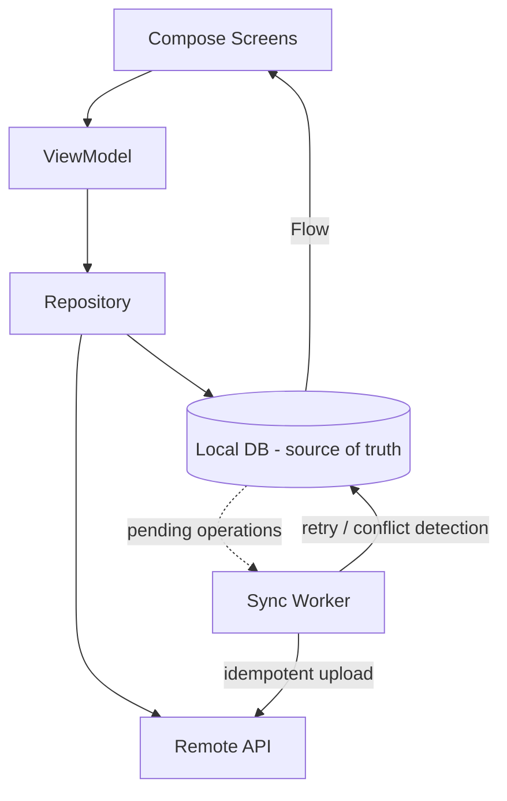

# incsync

**Offline-first personal notes for Android.** Your notes remain usable even when the internet doesn't.

> Status: **Milestone 2 complete** — Room is the local source of truth; notes survive process death.

## Why offline-first

Notes are written on the device first. The local database is the single source of truth for
everything the user sees; synchronization with the backend happens *independently* behind the UI.
The app never blocks on the network, never loses a keystroke to a flaky connection, and never
shows a spinner just to read a note.

## Architecture

```
Compose UI  ← StateFlow ←  ViewModel  ←  Repository  ←  Local data source (Room, Milestone 2)
                                              │              Remote data source (Retrofit, Milestone 3)
                                              └→ pending sync ops → WorkManager (Milestones 4–7)
```



**Rules of the architecture**

- UI renders immutable state; it never reaches into data sources.
- Every local write goes through the repository in one atomic step (note + pending sync op).
- Synchronization is persistent work (WorkManager), not a coroutine — it survives process death.
- Failures are classified: transient errors retry with backoff, permanent errors surface in the UI.

## Milestones completed

**M1 — Skeleton:** Gradle + version catalog, Kotlin 2.0, Compose, Material 3, Hilt;
adaptive shell (bottom bar on phones, navigation rail on wide screens); minimal "ink on
paper" theme with color reserved for sync state; screens: notes home, write-through
editor, offline search, folders shell, settings, sync status; repository interface with
an in-memory stand-in; 5 ViewModel unit tests.

**M2 — Room as source of truth:** `notes`/`folders` tables (client-generated UUID PK,
`version`, `syncState`, `deletedAt` from day one), DAOs with reactive `Flow` queries,
entity↔domain mapping at the repository boundary, `exportSchema` for future migration
tests; 12 instrumented tests (CRUD, version bumping, idempotent pin, idempotent-when-
same-value updates, DB reopen durability).

Verified on emulator: create → edit → search offline, **force-stop → relaunch → note
still there** (screenshots in `docs/screenshots/`).

## Project structure

```
app/src/main/java/com/inc/app/
├── IncSyncApp.kt          # Hilt application
├── MainActivity.kt        # single activity, theme + adaptive root
├── domain/                # models + repository interface (no framework deps)
├── data/
│   ├── local/             # Room entities, DAOs, database (source of truth)
│   └── repository/        # Room-backed repository (entity ↔ domain boundary)
├── di/                    # Hilt bindings (data + Room modules)
└── ui/
    ├── navigation/        # routes + NavHost
    ├── notes/             # home + editor
    ├── search/            # offline search
    ├── folders/           # folder shell (CRUD lands with Room)
    ├── settings/          # theme, sync entry, about
    ├── sync/              # sync status & history
    ├── components/        # sync chip, empty states
    └── theme/             # colors, type, shapes
```

## Build & run

```bash
./gradlew :app:assembleDebug            # build APK
./gradlew :app:testDebugUnitTest        # unit tests
./gradlew :app:connectedDebugAndroidTest  # instrumented tests (device/emulator required)
./gradlew :app:installDebug             # install on connected device/emulator
```

Requires JDK 17 and the Android SDK (compileSdk 35, minSdk 26).

## Roadmap

| Milestone | Scope |
|---|---|
| 2 | Room as the local source of truth | ✅ |
| 3 | Auth + FastAPI/PostgreSQL backend |
| 4–6 | Remote sync, offline write queue, WorkManager |
| 7–9 | Idempotency, retries, multi-device conflict detection & resolution |
| 10 | Search (FTS) + folders + polish |
| 11 | Testing & failure injection |
| 12 | Release build + Play Store preparation |

## Privacy

Note content is never logged, never sent to analytics, and never appears in crash reports.
Credentials will be stored with platform secure storage (Milestone 3).
