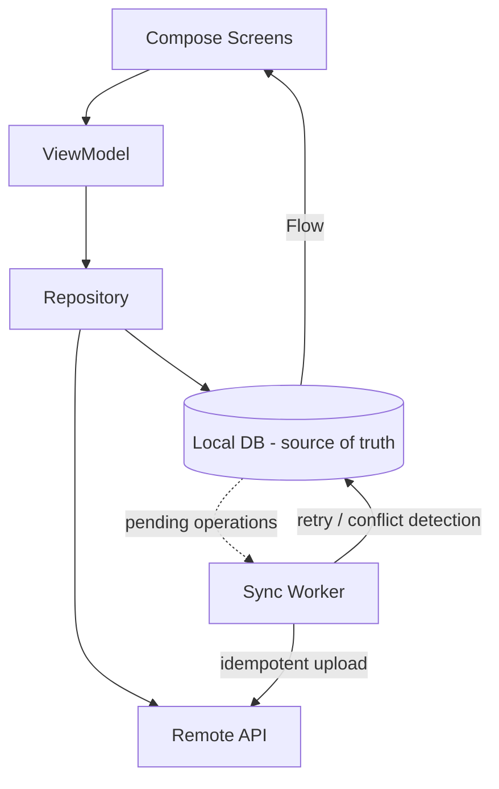

# incsync

**Offline-first personal notes for Android + FastAPI backend.** Notes are written to the
device first; the local database is the single source of truth for everything the user sees,
and synchronization with the backend happens independently behind the UI. The app never
blocks on the network, never loses a keystroke to a flaky connection, and never shows a
spinner just to read a note.

> Status: **Complete** — offline-first notes, auth, sync, search, folders, conflict
> resolution, and encrypted credential storage are implemented and tested.

## Table of contents

- [Why offline-first](#why-offline-first)
- [Architecture](#architecture)
- [Feature set](#feature-set)
- [Project structure](#project-structure)
- [Backend](#backend)
- [Build & run](#build--run)
- [Testing](#testing)
- [Configuration](#configuration)
- [Release build](#release-build)
- [Roadmap status](#roadmap-status)
- [Privacy & security](#privacy--security)

## Why offline-first

- **Local is the source of truth.** Every screen reads from Room via `Flow`; the UI
  recomposes automatically when data changes.
- **Writes are atomic.** A note change and its pending sync operation are persisted in a
  single Room transaction, so a process kill can never separate them.
- **Sync is persistent work.** WorkManager drains the pending-op queue with network
  constraints, exponential backoff, and survives process death.
- **Failures are classified.** Transient errors (I/O, 5xx) retry with backoff; permanent
  errors (4xx) are surfaced as `FAILED`/`CONFLICT` states in the UI.

## Architecture

```
Compose UI  ← StateFlow ←  ViewModel  ←  Repository  ←  Local data source (Room, source of truth)
                                                  │              Remote data source (Retrofit)
                                                  └→ pending sync ops → WorkManager
```



**Rules of the architecture**

- UI renders immutable state; it never reaches into data sources.
- Every local write goes through the repository in one atomic step (note + pending sync op).
- Synchronization is persistent work (WorkManager), not a coroutine — it survives process death.
- Failures are classified: transient errors retry with backoff, permanent errors surface in the UI.
- Domain models (`com.inc.app.domain`) have no framework annotations; persistence/network
  types are mapped at the repository boundary.

## Feature set

- **Notes** — create, edit (write-through, no save button), pin, delete (hard delete locally,
  queued DELETE sync).
- **Folders** — create, rename, delete; notes carry a `folderId`.
- **Offline search** — Room FTS4 full-text search over titles and bodies.
- **Sync** — idempotent push (CREATE/UPDATE/DELETE) with optimistic concurrency
  (`base_version`), conflict detection (409), retry with backoff, per-row `SyncState`.
- **Auth** — register/login/logout against the FastAPI backend; bearer-token interceptor;
  encrypted token storage (EncryptedSharedPreferences, AES-256).
- **Conflict resolution UI** — when a note diverges on the server, the editor offers
  "keep mine" or "use server version".
- **Adaptive UI** — bottom bar on phones, navigation rail on wide screens; Material 3
  "ink on paper" theme with color reserved for sync state.
- **Sync status** — app-wide chip aggregated from per-note states
  (`SYNCED`/`PENDING`/`FAILED`/`CONFLICT`).

## Project structure

```
app/src/main/java/com/inc/app/
├── IncSyncApp.kt          # Hilt application + WorkManager config
├── MainActivity.kt        # single activity, theme + adaptive root
├── domain/                # models + repository interface (no framework deps)
├── data/
│   ├── local/             # Room entities, DAOs, database, FTS
│   ├── remote/            # Retrofit API, DTOs, TokenStore
│   ├── repository/        # Room-backed repository (entity ↔ domain boundary)
│   └── sync/              # SyncWorker, SyncScheduler
├── di/                    # Hilt modules (data, network, Room)
└── ui/
    ├── navigation/        # routes + NavHost
    ├── notes/             # home + editor
    ├── search/            # FTS-backed search
    ├── folders/           # folder CRUD
    ├── settings/          # theme, account, about
    ├── sync/              # sync status & history
    ├── auth/              # login/register
    ├── components/        # sync chip, empty states
    └── theme/             # colors, type, shapes

server/                    # FastAPI + SQLAlchemy backend
```

## Backend

FastAPI service (Python 3.11+) with SQLAlchemy + Alembic-style migrations and JWT auth.

```bash
cd server
python -m venv .venv && source .venv/bin/activate   # Windows: .venv\Scripts\activate
pip install -r requirements.txt
DATABASE_URL="sqlite:///./dev.db" uvicorn app.main:app --reload --port 8000
```

Tests:

```bash
cd server
DATABASE_URL="sqlite:///:memory:" python -m pytest -q
```

## Build & run

Requires JDK 17 and the Android SDK (compileSdk 35, minSdk 26).

```bash
./gradlew :app:assembleDebug            # build APK
./gradlew :app:installDebug             # install on connected device/emulator
./gradlew :app:testDebugUnitTest        # JVM unit tests
./gradlew :app:connectedDebugAndroidTest # instrumented tests (device/emulator required)
```

The debug build points at `http://10.0.2.2:8000` (host loopback from the emulator).
The release build points at `https://api.example.com` (override via `API_BASE_URL`
build config in `app/build.gradle.kts`).

## Testing

- **Unit tests** (`app/src/test`) — `NotesViewModelTest` covers status aggregation
  with a fake repository; runs on the JVM.
- **Instrumented tests** (`app/src/androidTest`):
  - `RoomNotesRepositoryTest` — CRUD, version bumping, pending-op recording, DB reopen.
  - `NoteDaoTest` — DAO-level queries.
  - `MigrationTest` — verifies the v4→v5 migration preserves rows and rebuilds FTS.
  - `SyncWorkerTest` — failure injection: 5xx → `Result.retry()`, 2xx → `Result.success()`
    and pending-op drain.
- **Server tests** — 12 pytest cases covering auth, notes, folders, and conflict detection.

## Configuration

Optional release signing via `gradle.properties` or environment variables:

```
RELEASE_STORE_FILE=/path/to/keystore.jks
RELEASE_STORE_PASSWORD=...
RELEASE_KEY_ALIAS=...
RELEASE_KEY_PASSWORD=...
```

If unset, `assembleRelease` produces an unsigned APK (suitable for local verification).

## Release build

```bash
./gradlew :app:assembleRelease
```

Release builds enable R8/ProGuard (`isMinifyEnabled = true`) and ship with cleartext
traffic disabled. Point `API_BASE_URL` at your HTTPS production deployment before
shipping.

## Roadmap status

| Milestone | Scope | Status |
|---|---|---|
| 1 | Compose skeleton, adaptive shell, repository interface | ✅ |
| 2 | Room as the local source of truth | ✅ |
| 3 | Auth + FastAPI/PostgreSQL backend | ✅ |
| 4–6 | Remote sync, offline write queue, WorkManager | ✅ |
| 7–9 | Idempotency, retries, multi-device conflict detection & resolution | ✅ |
| 10 | Search (FTS) + folders + polish | ✅ |
| 11 | Testing & failure injection | ✅ |
| 12 | Release build + Play Store preparation | ✅ (signing optional) |

## Privacy & security

- Note content is never logged, never sent to analytics, and never appears in crash reports.
- Credentials are stored with `EncryptedSharedPreferences` (AES-256, Android Keystore-backed
  master key).
- Debug builds allow cleartext traffic for the local dev backend only; release builds
  require HTTPS.
- The backend uses JWT bearer tokens with a configurable secret (`SECRET_KEY`).